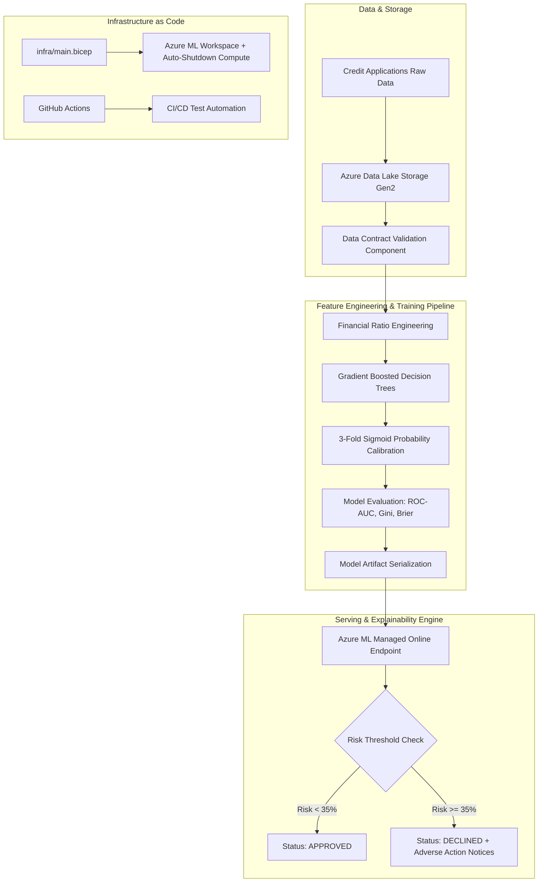

# FinShield: Regulatory-Compliant Credit Risk Scoring & MLOps Platform

[](tests/test_pipeline.py)
[](artifacts/metrics.json)
[](artifacts/metrics.json)
[](infra/main.bicep)
[](LICENSE)

An enterprise-grade, end-to-end Machine Learning Operations (MLOps) platform built for **FinTech and Banking Credit Underwriting**. FinShield predicts loan default probabilities with **calibrated risk models** and automatically generates legally mandated **Adverse Action Reason Codes** in compliance with US Consumer Financial Protection Bureau (CFPB) and Equal Credit Opportunity Act (ECOA) regulations.

---

## 🏛️ Business Context & Regulatory Compliance

In retail lending and credit cards, automated machine learning models cannot simply output a black-box probability. Under federal and international lending regulations:
1. **Model Probability Calibration:** Raw tree scores must be calibrated (Brier Score minimization) so that a predicted $0.20$ default probability accurately reflects a true $20\%$ historical charge-off rate.
2. **Adverse Action Notices (ECOA / Regulation B):** If a borrower is declined, the institution must disclose the top key factors that adversely affected their credit score (e.g., *debt-to-income ratio exceeds threshold*, *high revolving balance utilization*).
3. **Reproducibility & Auditability:** Training data contracts, preprocessor pipelines, and model artifacts must be immutably versioned and tested.

---

## 📐 System Architecture



---

## 📊 Model Performance Benchmark

Evaluated on a strictly held-out $20\%$ test set ($2,000$ applications):

| Metric | Score | Financial Industry Standard |
| :--- | :--- | :--- |
| **ROC-AUC** | **0.8716** | $\ge 0.75$ (Strong discrimination) |
| **Gini Coefficient** | **0.7432** | $\ge 0.60$ (Required by Credit Risk Committees) |
| **PR-AUC (Avg Precision)** | **0.6158** | Outperforms baseline default prevalence ($15.45\%$) |
| **Brier Score Loss** | **0.0878** | $< 0.12$ (High calibration fidelity) |

### Top Predictive Risk Drivers
1. **Credit Bureau Score** ($32.6\%$ importance)
2. **Revolving Stress Index** ($24.2\%$ importance) — *Interaction between high utilization and credit deficit*
3. **Debt-to-Income Ratio (DTI)** ($9.8\%$ importance)
4. **Delinquency Severity** ($8.8\%$ importance) — *30+ day delinquencies weighted by DTI*
5. **Interest Rate APR** ($8.3\%$ importance)

---

## 🗂️ Project Directory Structure

```text
azure-fintech-mlops/
├── .github/workflows/
│   └── mlops_ci_cd.yml         # GitHub Actions automated test & Bicep validation
├── artifacts/
│   ├── metrics.json            # Benchmarked model metrics
│   └── model_pipeline.joblib   # Serialized preprocessor + calibrated model
├── data/
│   ├── raw/                    # Raw credit applications dataset
│   ├── processed/              # Feature engineered data & validation reports
│   └── test/                   # Sample payloads for API simulation
├── infra/
│   └── main.bicep              # Azure IaC (AML, ADLS Gen2, Key Vault, ACR)
├── pipelines/
│   ├── azureml_pipeline.py     # Azure ML v2 SDK pipeline definition
│   └── pipeline_job.yaml       # Azure ML v2 Cloud Job Manifest
├── src/
│   ├── data_validation.py      # Enterprise data contract auditor
│   ├── feature_engineering.py  # Domain-specific financial ratio transformers
│   ├── train.py                # Model training, calibration & artifact generator
│   ├── explainability.py       # ECOA/CFPB Adverse Action reason code engine
│   └── score.py                # Azure ML Managed Online Endpoint scoring script
├── tests/
│   └── test_pipeline.py        # Automated test suite (5 tests passing)
├── requirements.txt            # Dependencies
└── README.md
```

---

## 🚀 Quickstart: Local Execution

### 1. Run Data Contract Validation
```powershell
python src/data_validation.py
```

### 2. Feature Engineering & Model Training
```powershell
python src/feature_engineering.py
python src/train.py
```

### 3. Test Inference & Explainability Locally
```powershell
python src/score.py
```

### 4. Run Automated Test Suite
```powershell
python -m unittest discover -s tests -p "test_*.py"
```

---

## 📡 Sample Production Endpoint Responses

### 1. Approved Application (Prime Borrower)
```json
{
  "applicant_id": "APP-10107",
  "risk_probability": 0.024,
  "underwriting_decision": "APPROVED",
  "decision_threshold": 0.35,
  "adverse_action_reasons": []
}
```

### 2. Declined Application with Adverse Action Notices (Subprime Borrower)
```json
{
  "applicant_id": "APP-15168",
  "risk_probability": 0.4925,
  "underwriting_decision": "DECLINED",
  "decision_threshold": 0.35,
  "adverse_action_reasons": [
    {
      "factor": "delinquencies_2yrs",
      "regulatory_notice": "Recent delinquencies or late payments on bureau file (2 incidents)"
    },
    {
      "factor": "credit_score",
      "regulatory_notice": "Credit bureau score below prime threshold (589)"
    },
    {
      "factor": "revolving_utilization",
      "regulatory_notice": "Proportion of revolving credit balances to credit limits is too high (63.0%)"
    }
  ]
}
```

---

## ☁️ Azure Cloud Deployment (When Ready)

To deploy to Microsoft Azure:
```bash
# 1. Login to Azure
az login

# 2. Deploy Infrastructure via Bicep
az group create --name rg-finshield-prod --location eastus
az deployment group create --resource-group rg-finshield-prod --template-file infra/main.bicep

# 3. Submit Azure ML Pipeline Job
az ml job create --file pipelines/pipeline_job.yaml --resource-group rg-finshield-prod --workspace-name finshield-aml-dev
```

---

## 🛡️ License
Distributed under the Apache 2.0 License.
